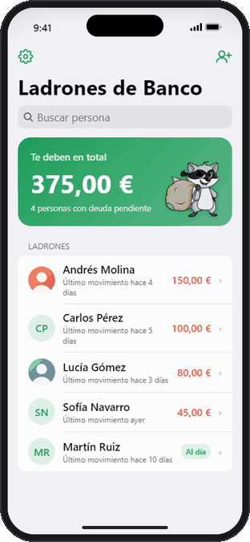
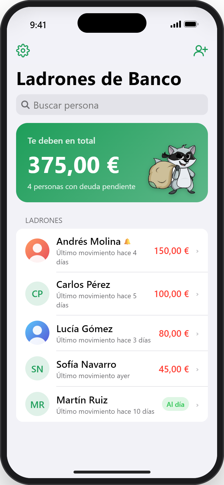
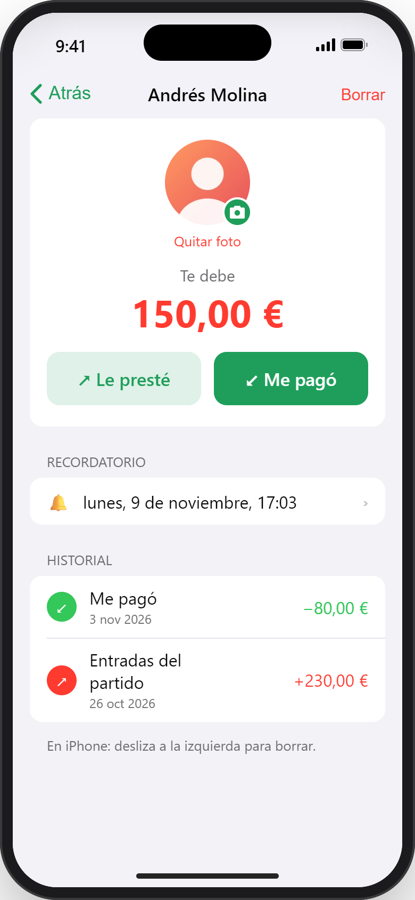
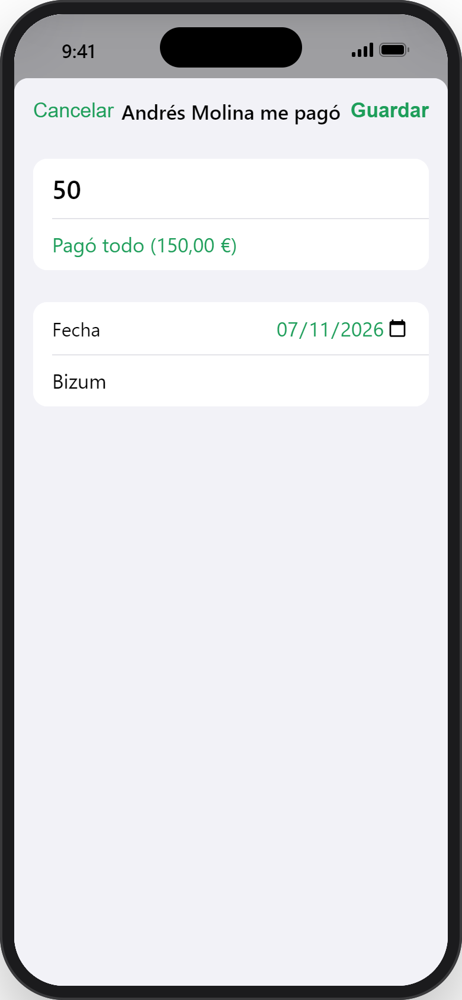
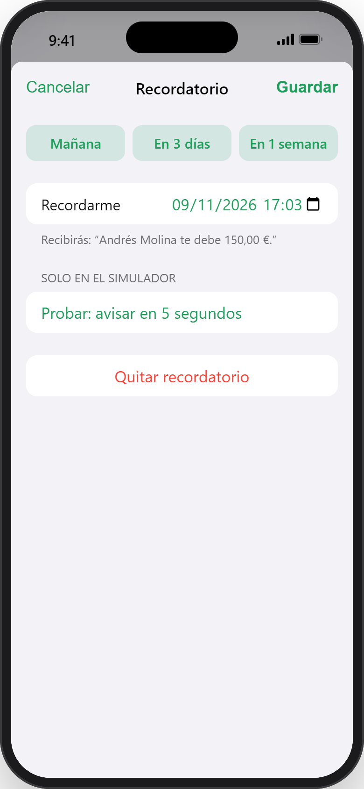
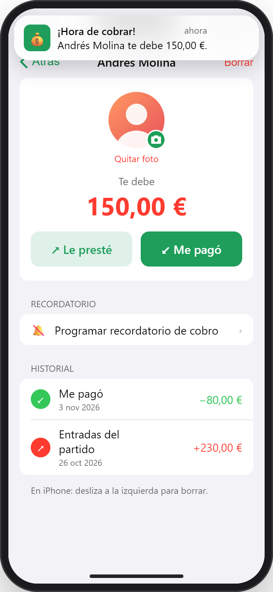
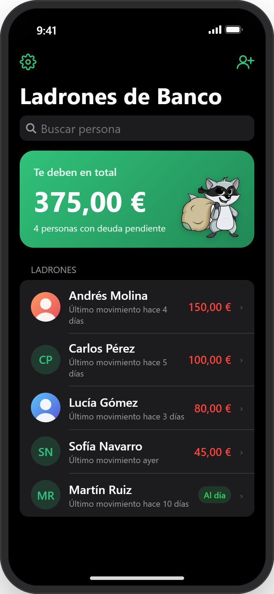

<p align="center">
  
</p>

<h1 align="center">Ladrones de Banco</h1>

<p align="center">
  <a href="README.md">English</a> · <strong>Español</strong>
</p>

**Ladrones de Banco** es una app de iPhone para llevar la cuenta de **quién te debe dinero** y no perderla nunca. Añades a las personas, apuntas lo que les prestas y cada pago que te devuelven, aunque sea parcial, y te avisa cuando toca cobrar. Su mascota es un mapache ladrón con antifaz y un saco del botín.

Está hecha con SwiftUI y SwiftData, se desarrolla en Windows, se compila en la nube con GitHub Actions y se instala en el iPhone con AltStore, sin pasar por la App Store.

<p align="center">
  
</p>

## Capturas

<table>
  <tr>
    <td align="center"><br><sub>Total que te deben y quién</sub></td>
    <td align="center"><br><sub>Saldo, recordatorio e historial</sub></td>
    <td align="center"><br><sub>Pagos parciales o completos</sub></td>
  </tr>
  <tr>
    <td align="center"><br><sub>Recordatorios de cobro</sub></td>
    <td align="center"><br><sub>La notificación que recibes</sub></td>
    <td align="center"><br><sub>Modo oscuro</sub></td>
  </tr>
</table>

Las capturas salen del simulador web incluido en el repositorio. Las personas y los importes son inventados.

## Funcionalidades

- **Total que te deben** de un vistazo, y lista ordenada por deuda con buscador.
- **Detalle por persona:** apunta lo que le prestaste («Le presté») y lo que te devolvió («Me pagó»), con pagos parciales o «Pagó todo» en un toque. El historial guarda cada movimiento.
- **Fechas:** por defecto la de hoy, y se pueden cambiar. No se permiten fechas futuras.
- **Recordatorios:** notificaciones locales para cobrar, con atajos (mañana, en 3 días, en una semana). Se cancelan solos cuando la deuda queda saldada, y el mensaje se actualiza si cambia el importe.
- **Foto de perfil** desde la galería, sin pedir permiso de acceso a las fotos gracias a `PhotosPicker`.
- **Ajustes:** tema Automático, Claro u Oscuro. La moneda sigue por defecto el *Idioma y región* del iPhone y se puede cambiar por cualquier otra. Cambiar de moneda no convierte los importes.
- Los datos se quedan en el iPhone con **SwiftData**. No hay cuentas ni servidor.

## Tecnología

| | |
|---|---|
| Lenguaje | Swift 5 |
| Interfaz | SwiftUI, iOS 17+, solo iPhone |
| Datos | SwiftData |
| Notificaciones | `UserNotifications` (locales, `UNCalendarNotificationTrigger`) |
| Preferencias | `@AppStorage` |
| Compilación | Xcode 16+ (proyecto con carpetas sincronizadas) · GitHub Actions en `macos-15` |

## Estructura del proyecto

```
LadronesDeBanco/
├── LadronesDeBancoApp.swift     Punto de entrada y delegado de notificaciones
├── Models/
│   ├── Modelos.swift            Persona y Movimiento (SwiftData), saldo
│   ├── Recordatorios.swift      Programar y cancelar recordatorios
│   └── Ajustes.swift            Tema y moneda
├── Views/
│   ├── ContentView.swift        Inicio: total y lista de personas
│   ├── DetallePersonaView.swift Saldo, recordatorio e historial
│   ├── Formularios.swift        Nueva persona, pago/préstamo y recordatorio
│   ├── FotoPerfil.swift         Avatar y selector de fotos
│   └── AjustesView.swift        Ajustes y selector de moneda
└── Assets.xcassets              Ícono, logo y color de acento
simulador/index.html             Réplica web interactiva de la app
.github/workflows/compilar-ipa.yml  Compila el .ipa en GitHub
compilar-ipa.sh                  Compila el .ipa en cualquier Mac
```

## Probarla sin Mac

Abre [`simulador/index.html`](simulador/index.html) en cualquier navegador. Es una réplica interactiva de la app dentro de un marco de iPhone, así que puedes probar todas las pantallas desde Windows o Linux. Incluso tiene un botón «avisar en 5 segundos» para probar los recordatorios.

## Compilar

Las apps de iOS solo se compilan con Xcode en macOS. Hay dos formas de conseguir el `.ipa` sin tener una Mac propia:

1. **GitHub Actions (recomendada):** cada push a `main` compila la app en una Mac de GitHub. Descarga el *artifact* `LadronesDeBanco-ipa` de la ejecución en la pestaña **Actions**. El workflow falla si la app sale sin su ejecutable compilado, y siempre sube el registro completo como `compilacion-log`.
2. **Cualquier Mac con Xcode 16+:** ejecuta `bash compilar-ipa.sh` y deja `LadronesDeBanco.ipa` en la carpeta del proyecto.

Las dos dan un `.ipa` **sin firmar**. La herramienta que lo instala lo firma con tu Apple ID. También puedes abrir `LadronesDeBanco.xcodeproj` en Xcode y ejecutarla directamente en tu iPhone.

## Instalarla en el iPhone (AltStore, desde Windows)

1. Instala **iTunes** e **iCloud** desde la web de Apple, no desde la Microsoft Store. La guía de AltStore tiene un enlace directo para iCloud.
2. Instala **AltServer 1.8.1 o posterior**. La 1.8.0 falla al iniciar sesión con Apple con los errores -80045 / -80046.
3. Conecta el iPhone por cable y elige AltServer (ícono junto al reloj) → **Install AltStore**. En el iPhone, confía en el perfil de tu Apple ID y activa el **Modo desarrollador**.
4. En AltStore, ve a **My Apps** → **+** y elige `LadronesDeBanco.ipa`.

Con un Apple ID gratuito la app dura **7 días**. AltStore la renueva por Wi-Fi mientras AltServer está abierto, o puedes renovarla por cable desde **My Apps → Refresh All**. Tus datos se conservan al renovarla, e incluso si llega a caducar.

La guía paso a paso completa está en [INSTALAR-ALTSTORE.md](INSTALAR-ALTSTORE.md).

## Cómo contribuir

Las contribuciones son bienvenidas: avisos de errores, ideas y *pull requests*. Lee la [guía para contribuir](CONTRIBUTING.es.md) para ver cómo avisar de un error, el estilo del código, cómo comprobar que la app compila y algunas ideas pendientes.

## Notas

- Proyecto personal, no publicado en la App Store. Publicarla requeriría una cuenta de pago de Apple Developer.

## Licencia

El código fuente se publica bajo la [licencia MIT](LICENSE).

El dibujo del mapache es de terceros y **no está incluido** en esa licencia. Eso abarca el ícono, el logo (`AppIcon.appiconset/icono.png`, `Logo.imageset/logo.png`) y la copia incrustada en el simulador. Aquí se usa solo con fines personales. Si reutilizas o publicas la app, sustitúyelo por una ilustración propia.
