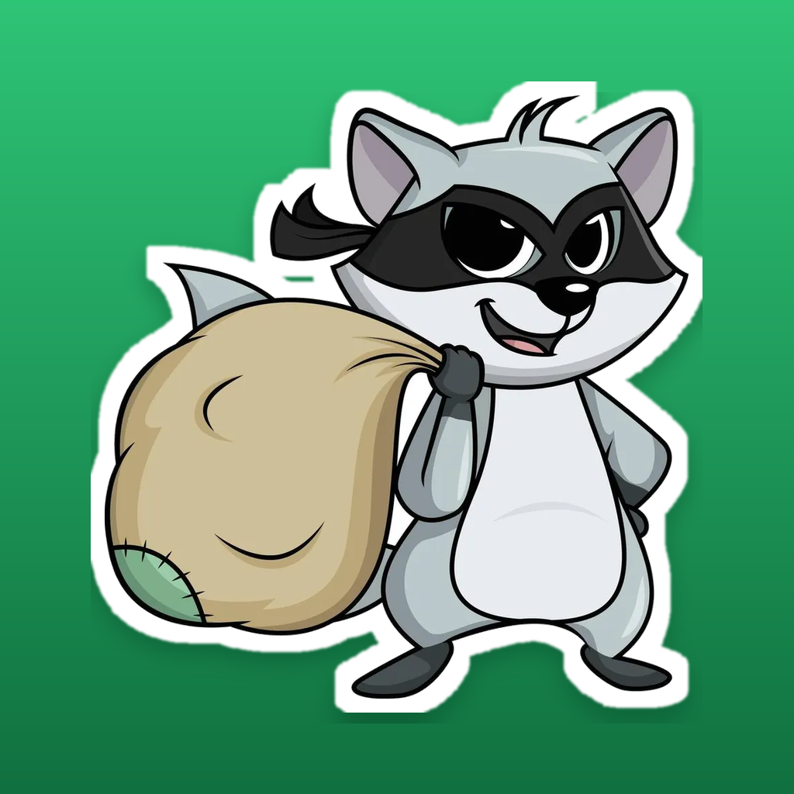
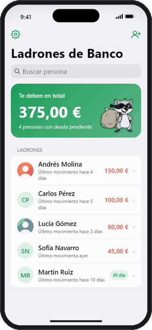
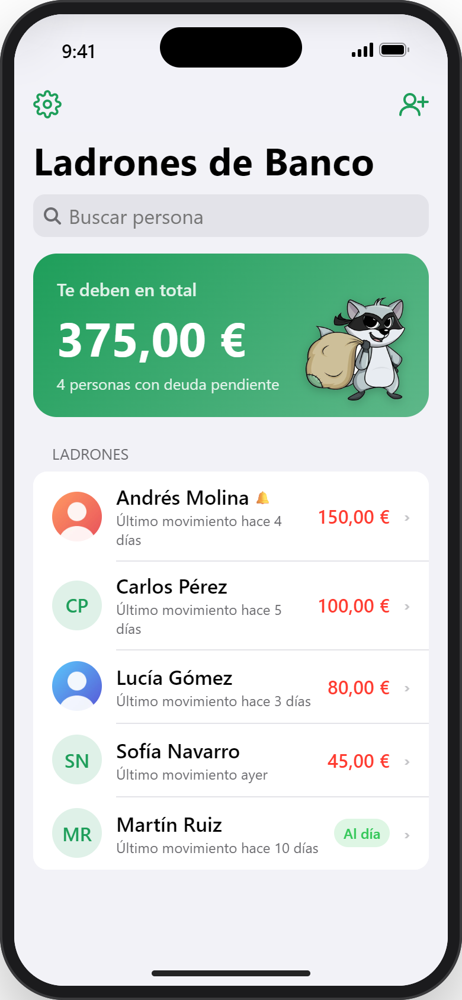
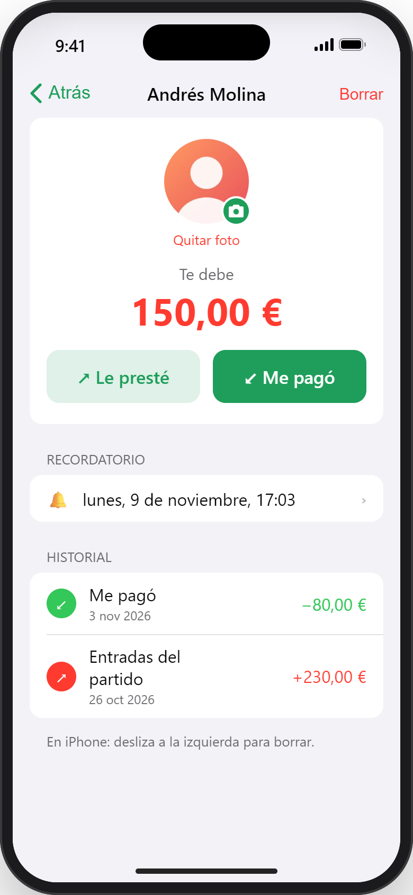
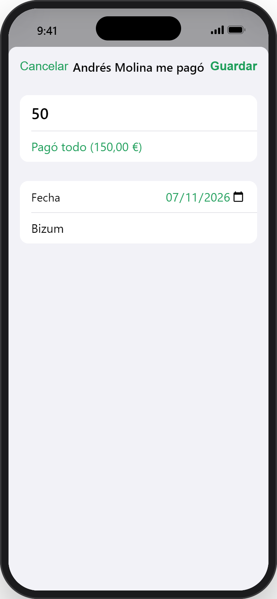
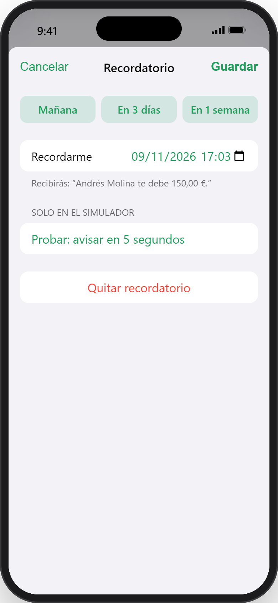
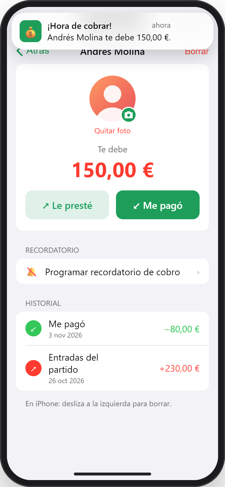
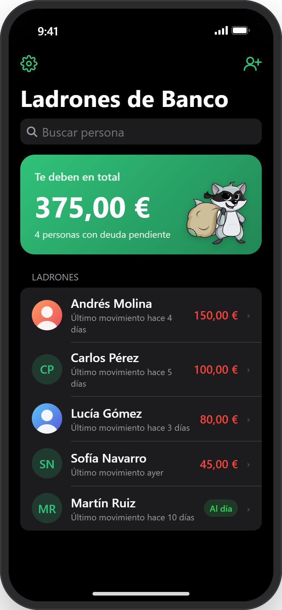

<p align="center">
  
</p>

<h1 align="center">Ladrones de Banco</h1>

<p align="center">
  <strong>English</strong> · <a href="README.es.md">Español</a>
</p>

**Ladrones de Banco** ("bank robbers") is an iPhone app for keeping track of **who owes you money**, so you never lose count. Add people, log what you lend and every payment they make back, partial ones included, and get a reminder when it's time to collect. Its mascot is a masked raccoon carrying a bag of loot.

It's built with SwiftUI and SwiftData, developed on Windows, compiled in the cloud with GitHub Actions and installed on the iPhone with AltStore, without going through the App Store.

<p align="center">
  
</p>

## Screenshots

<table>
  <tr>
    <td align="center"><br><sub>Total owed and who owes it</sub></td>
    <td align="center"><br><sub>Balance, reminder and history</sub></td>
    <td align="center"><br><sub>Partial or full payments</sub></td>
  </tr>
  <tr>
    <td align="center"><br><sub>Collection reminders</sub></td>
    <td align="center"><br><sub>The notification you get</sub></td>
    <td align="center"><br><sub>Dark mode</sub></td>
  </tr>
</table>

The screenshots come from the web simulator included in the repository. The people and amounts are made up.

## Features

- **Total owed** at a glance, plus a list sorted by debt with search.
- **Per-person detail:** log what you lent ("Le presté") and what they paid back ("Me pagó"), with partial payments or a one-tap "paid in full". The history keeps every movement.
- **Dates** default to today and can be changed. Future dates aren't allowed.
- **Reminders:** local notifications to collect a debt, with quick picks (tomorrow, in 3 days, in a week). They cancel themselves when the debt is settled, and the message updates if the amount changes.
- **Profile photos** from the photo library, with no photo-access permission needed thanks to `PhotosPicker`.
- **Settings:** Automatic, light or dark theme. The currency follows the iPhone's *Language & Region* by default and can be changed to any other. Changing currency doesn't convert amounts.
- Data stays on the device with **SwiftData**. There's no account and no server.

The interface is in Spanish.

## Tech stack

| | |
|---|---|
| Language | Swift 5 |
| UI | SwiftUI, iOS 17+, iPhone only |
| Storage | SwiftData |
| Notifications | `UserNotifications` (local, `UNCalendarNotificationTrigger`) |
| Preferences | `@AppStorage` |
| Build | Xcode 16+ (project with synchronized folders) · GitHub Actions on `macos-15` |

## Project structure

```
LadronesDeBanco/
├── LadronesDeBancoApp.swift     App entry point and notification delegate
├── Models/
│   ├── Modelos.swift            Persona and Movimiento (SwiftData), balance
│   ├── Recordatorios.swift      Schedule and cancel reminders
│   └── Ajustes.swift            Theme and currency
├── Views/
│   ├── ContentView.swift        Home: total and list of people
│   ├── DetallePersonaView.swift Balance, reminder and history
│   ├── Formularios.swift        New person, payment/loan and reminder forms
│   ├── FotoPerfil.swift         Avatar and photo picker
│   └── AjustesView.swift        Settings and currency picker
└── Assets.xcassets              App icon, logo and accent colour
simulador/index.html             Interactive web replica of the app
.github/workflows/compilar-ipa.yml  Builds the .ipa on GitHub
compilar-ipa.sh                  Builds the .ipa on any Mac
```

## Try it without a Mac

Open [`simulador/index.html`](simulador/index.html) in any browser. It's an interactive replica of the app inside an iPhone frame, so you can try every screen from Windows or Linux. It even has a "notify me in 5 seconds" button to test reminders.

## Build

iOS apps can only be compiled with Xcode on macOS. There are two ways to get the `.ipa` without owning a Mac:

1. **GitHub Actions (recommended):** every push to `main` builds the app on a GitHub-hosted Mac. Download the `LadronesDeBanco-ipa` artifact from the run in the **Actions** tab. The workflow fails if the app comes out without its compiled executable, and it always uploads the full build log as `compilacion-log`.
2. **Any Mac with Xcode 16+:** run `bash compilar-ipa.sh` and it leaves `LadronesDeBanco.ipa` in the project folder.

Both produce an **unsigned** `.ipa`. The tool that installs it signs it with your Apple ID. You can also open `LadronesDeBanco.xcodeproj` in Xcode and run it straight on your iPhone.

## Install on your iPhone (AltStore, from Windows)

1. Install **iTunes** and **iCloud** from Apple's website, not from the Microsoft Store. AltStore's guide has a direct iCloud download link.
2. Install **AltServer 1.8.1 or later**. Version 1.8.0 fails to sign in to Apple with errors -80045 / -80046.
3. Connect the iPhone by cable and choose AltServer (tray icon) → **Install AltStore**. On the iPhone, trust your Apple ID profile and turn on **Developer Mode**.
4. In AltStore, go to **My Apps** → **+** and pick `LadronesDeBanco.ipa`.

With a free Apple ID the app lasts **7 days**. AltStore refreshes it over Wi-Fi while AltServer is running, or you can refresh it over a cable from **My Apps → Refresh All**. Your data survives a refresh, and even an expiry.

There's a detailed step-by-step guide, in Spanish, in [INSTALAR-ALTSTORE.md](INSTALAR-ALTSTORE.md).

## Notes

- Personal project, not published on the App Store. Publishing it would require a paid Apple Developer account.

## License

The source code is released under the [MIT License](LICENSE).

The raccoon artwork is third-party and **is not covered** by that license. That includes the app icon, the logo (`AppIcon.appiconset/icono.png`, `Logo.imageset/logo.png`) and the copy embedded in the simulator. It's used here for personal purposes only. Replace it with your own artwork if you reuse or publish the app.
